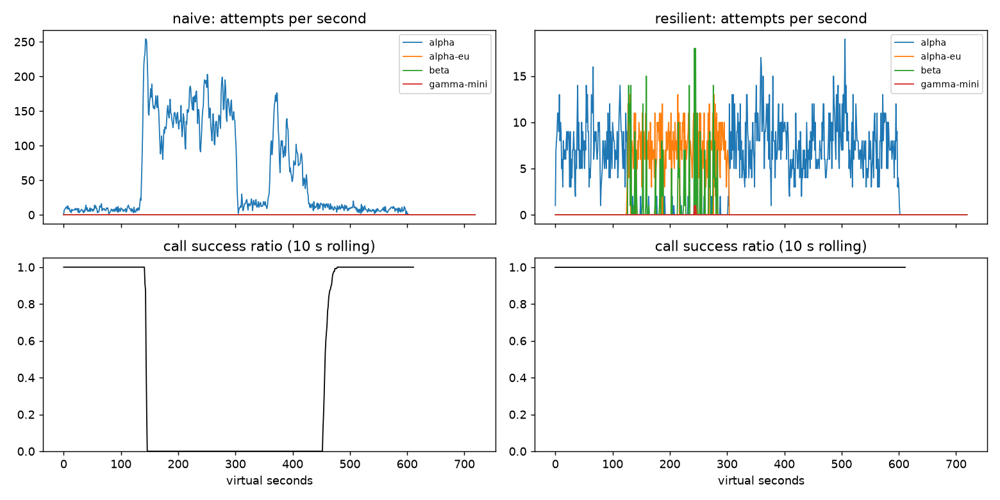

# Lab 25B — Report: ShopAgent Reliability Game Day

**Họ tên:** Trần Quốc Vượng — **MSSV:** 2A202602522.
**Commit source/evidence:** `2f8dd8c600b80e3875f409f29c2547abc8a5991c`. Phiên bản nộp đủ report: tag `day25-submission-20261013`.
**Điểm tự động:** 84.0/88; đạt toàn bộ 84 điểm kiểm tra public. 4 điểm SLO hidden chờ giảng viên,
12 điểm report/postmortem chấm tay, chưa tự cộng vào điểm đã xác minh.

Môi trường: Python 3.11.15 trên Windows, cài editable với `.[dev,plot]`, `pip check` đạt.
Tất cả latency, chi phí và sự cố dưới đây là **đầu ra simulator với thời gian ảo**, không phải API production.
Seed chính 25; kiểm tra bổ sung 26/27 đều đạt 6/6 băng và C1. Không cần API key, không dùng dữ liệu cá nhân thật.
Nguồn số: `gameday/*.json`, `cache/*.json`, `workflows.json`, `slo.json`, `experiments.json`, `scoreboard*.json`.
Scenarios, simulator, tests được cấp và services được giữ nguyên.

## 1. Kết quả Game Day (naive vs resilient)

| Băng | Client | availability | p95 (s) | amplification | retry_ratio | cost/good turn | recovery (s) | Kết quả |
| --- | --- | --- | --- | --- | --- | --- | --- | --- |
| G1 | naive | 0.7194 | 7.157 | 7.738 | 6.738 | 2.163 | 4.0 | FAIL |
| G1 | resilient | 1.0 | 4.732 | 1.061 | 0.003 | 2.099 | 0.0 | PASS |
| G2 | naive | 0.456 | 15.034 | 9.904 | 8.904 | 4.627 | 155.0 | FAIL |
| G2 | resilient | 1.0 | 4.908 | 1.025 | 0.006 | 2.088 | 0.0 | PASS |
| G3 | naive | 1.0 | 4.768 | 1.164 | 0.164 | 2.328 | 0.0 | FAIL |
| G3 | resilient | 1.0 | 4.642 | 1.035 | 0.019 | 2.101 | 0.0 | PASS |
| G4 | naive | 1.0 | 13.764 | 1.004 | 0.004 | 2.008 | 0.0 | FAIL |
| G4 | resilient | 0.9995 | 5.419 | 1.036 | 0.007 | 2.124 | 0.0 | PASS |
| G5 | naive | 0.3699 | 5.359 | 17.03 | 16.03 | 2.124 | N/A | FAIL |
| G5 | resilient | 0.8175 | 5.484 | 1.009 | 0.007 | 2.513 | N/A | PASS |
| G6 | naive | 0.517 | 4.836 | 12.344 | 11.344 | 2.009 | 0.0 | FAIL |
| G6 | resilient | 1.0 | 6.081 | 1.061 | 0.024 | 2.207 | 0.0 | PASS |

P95 chỉ tính trên lượt **thành công**; không thể suy availability tốt từ P95 thấp.
`N/A` nghĩa là băng không định nghĩa mốc restore, không phải recovery bằng 0.
`recovery_s=0` nghĩa là cửa sổ 30 giây đầu tiên sau restore đạt ≥95% call thành công;
không chứng minh provider hết lỗi ngay tức thì. Primary share sau restore: G2/G4/G6 đều 1,000 ở seed 25.
G1 có 0 vi phạm retry-after; G5 có 0 retry lỗi 400 và 0 failover không cần thiết;
G6 có 0 incompatible routes. G5 còn 414
lượt thất bại do input sai/giới hạn xử lý, được giữ nguyên thay vì retry mọi lỗi để che sự cố deploy.

## 2. Cấu hình client và lý do

| Tham số | Giá trị | Evidence và lý do |
| --- | --- | --- |
| attempt_timeout_s | 4,0 | G2 P95 giảm 11,874 → 5,224 khi đổi riêng timeout 8 → 4 s, rồi còn 4,908 khi hạ slow threshold; dành thời gian cho fallback trong deadline 30 s |
| max_attempts_per_provider | 2 | Tối đa một retry transient; G3 retry_ratio=0,019, thấp hơn ngưỡng 0,10 |
| min_time_left_s | 1,0 | Không cấp attempt vô nghĩa sát deadline; timeout luôn bị cap theo thời gian còn lại |
| backoff_base_s / cap_s | 0,25 / 4,0 | Full jitter phân tán retry; G2 amplification=1,025, không còn 9,904 như naive |
| retry_budget_ratio / min_per_s / max_tokens | 0,10 / 0,5 / 20 | Giới hạn retry khi breaker bị cấu hình sai; xem mục 3. Initial burst và refill nghĩa là không phải trần cứng 10% ở mọi cửa sổ |
| breaker.window_size / min_calls | 20 / 10 | Tỷ lệ trên cửa sổ gần nhất, tránh trip từ vài lỗi đơn lẻ; G3 vẫn đạt availability=1,000 |
| breaker.failure_rate_threshold | 0,50 | Tránh giữ traffic ở provider hỏng; G2/G6 recovery=0 s theo định nghĩa scorer |
| breaker.slow_call_s / slow_rate_threshold | 3,0 / 0,60 | Phát hiện cả success chậm trước timeout 4 s; G2 P95 5,224 → 4,908, G4 P95=5,419 ≤10 s |
| breaker.open_duration_s | 10,0 | Chừa thời gian drain rồi thăm dò; G2/G4/G6 trả 100% attempt về primary trong cửa sổ sau restore |
| half_open_max_probes / successes | 2 / 2 | Chỉ hai probe đang bay, đóng sau hai success nhanh; tests kiểm tra stale generation và concurrency |
| quota_cooldown_s | 300 | Hết credit không tự hết sau một retry; G5 chỉ 2 quota errors (mỗi deployment A), rồi chuyển sang B |
| cache threshold / TTL / stale | 0,90 / 30 / 300 s | Chọn từ thí nghiệm mục 8, không hard-code tên intent, tài liệu hoặc thời điểm sự cố |

Decision table của `on_error`:

| Loại lỗi | Breaker | Retry cùng provider | Failover / cooldown |
| --- | --- | --- | --- |
| 400/401/403/404/422 và lỗi client khác | release permit, không ghi health | Không | GiveUp(client_error), không failover |
| 429 insufficient_quota | release | Không | Cooldown 300 s, đi deployment tiếp theo |
| 429 rate_limit_exceeded | release | Không retry ngay | Cooldown shared ít nhất retry-after, spillover ngay; chỉ đợi cooldown ngắn ≤5 s khi hết lựa chọn |
| 529/503, 5xx, timeout | on_failure | Nếu còn attempts, breaker cho phép, budget có token và còn deadline; full jitter | Nếu không đủ điều kiện, đi provider kế tiếp |
| Success chậm | on_success với latency | Không | Đóng góp slow rate, có thể OPEN |
| Cancel delayed attempt | release permit | Không | Không ghi lỗi health |

Ladder giữ thứ tự từ config và lọc `supports_tools` cho task tool. Mỗi logical call chỉ có một tầng retry.
Không dùng `time.sleep` hay đồng hồ thực trong logic client. Kết quả có generation cũ bị breaker bỏ qua.

## 3. Ba thí nghiệm bắt buộc

Script tái lập: `python scripts/run_experiments.py`; overrides chỉ nằm trong bản sao config hoặc subclass
control của script, không sửa client production hay các băng được cấp. Mọi bảng ở mục này dùng seed 25.

### 3.1. Retry budget là lớp phòng thủ cuối

Breaker hỏng: `min_calls=1000000000`, `max_attempts_per_provider=5`; budget-off dùng ratio=100,
max_tokens=1e9, min_per_s=1e6 đúng yêu cầu. Bảng healthy giữ max_attempts=2 và cấu hình cuối.

| Breaker | Budget | Băng | Availability | Amplification | Retry ratio | Recovery s | P95 s |
| --- | --- | --- | --- | --- | --- | --- | --- |
| healthy | on | G2 | 1.0 | 1.025 | 0.006 | 0.0 | 4.908 |
| healthy | on | G3 | 1.0 | 1.035 | 0.019 | 0.0 | 4.642 |
| healthy | off | G2 | 1.0 | 1.025 | 0.006 | 0.0 | 4.908 |
| healthy | off | G3 | 1.0 | 1.035 | 0.019 | 0.0 | 4.642 |
| broken | on | G2 | 0.9996 | 1.424 | 0.062 | 0.0 | 11.911 |
| broken | on | G3 | 1.0 | 1.136 | 0.068 | 0.0 | 4.568 |
| broken | off | G2 | 0.9822 | 1.8 | 0.509 | 0.0 | 18.868 |
| broken | off | G3 | 1.0 | 1.163 | 0.16 | 0.0 | 4.809 |

Khi breaker hỏng, budget giảm amplification G2 từ 1,800 xuống 1,424 và retry_ratio từ 0,509 xuống 0,062;
P95 giảm 18,868 xuống 11,911 s. G3 giữ availability=1 nhưng retries giảm 0,160 → 0,068, tiết kiệm attempt
không làm mất kết quả. Recovery G2 của cả hai control vẫn là 0 theo cửa sổ scorer, nên thí nghiệm này chứng minh
giảm tải/P95, không chứng minh cải thiện recovery trên seed này. Khi breaker hoạt động đúng, bật/tắt budget cho
kết quả giống nhau ở hai băng này: breaker đã cắt tải trước khi token cạn; vẫn giữ budget để chống cấu hình sai
và những degradation nằm dưới ngưỡng trip.

### 3.2. Timeout 30 giây

| Băng | Timeout s | Availability | P95 s (successful turns) | P99 s |
| --- | --- | --- | --- | --- |
| G4 | 4 | 0.9995 | 5.419 | 8.812 |
| G4 | 30 | 1.0 | 5.608 | 8.952 |
| G6 | 4 | 1.0 | 6.081 | 8.774 |
| G6 | 30 | 0.9488 | 5.502 | 6.666 |

G4 vẫn được breaker xử lý qua slow successes, nên timeout 30 s không làm availability sụp ở băng này.
G6 availability giảm 1,000 → 0,9488: một attempt treo ở alpha-eu có thể dùng hết deadline của user,
không còn thời gian cho beta. P95 G6 giảm trong control **không có nghĩa nhanh hơn cho mọi người** vì nó chỉ
tính trên lượt thành công; các lượt treo đã rơi khỏi mẫu. Timeout nên dựa vào phân bố latency khỏe, deadline
toàn lượt và số fallback còn cần, rồi kiểm tra false timeout; không lấy 30 s của user cho từng LLM call.

### 3.3. Bỏ lọc tool calling

G6 control không lọc tạo **269 incompatible routes**, availability
0.8872 thay cho 1,000 khi có lọc. Các yêu cầu đó bị trả `incompatible_model_output`.
Với người dùng, đây là agent không thể gọi tool hoàn tiền dù nhận được text từ model: model rẻ hơn nhưng không
có chức năng cần thiết không phải phương án thay thế hợp lệ. Chỉ chat được phép dùng gamma-mini.

## 4. Workflow hoàn tiền

| Executor | Completion | Crashes | Refund trùng | Email trùng | Refund mất | Overpaid cents | LLM lãng phí/crash |
| --- | --- | --- | --- | --- | --- | --- | --- |
| naive | 1.0 | 81 | 128 | 81 | 0 | 1574200 | 1.123 |
| yours | 1.0 | 66 | 0 | 0 | 0 | 0 | 0.303 |

Key là SHA256 của danh tính `[session_id, step]`, giữ ổn định qua retry/restart và tách payment khỏi email.
Mỗi step thành công mới checkpoint; worker mới nạp lại state rồi chỉ chạy step còn thiếu. WorkerCrash được
propagate, chỉ ServiceError/ServiceTimeout được retry có giới hạn.
Idempotency riêng ngăn tiền/email trùng nhưng không ngăn lặp classify/lookup/summary và mất chi phí LLM;
checkpoint riêng vẫn có khoảng hở payment đã commit nhưng worker chết trước lúc lưu checkpoint.
Kết hợp cả hai giải quyết khoảng hở đó: phát lại cùng key nhận kết quả cũ rồi checkpoint.
Nếu checkpoint **trước** payment, worker chết giữa hai thao tác có thể resume bằng cách bỏ qua một khoản tiền
chưa hề chuyển; đó là lost refund. Exactly-once ở đây là **effect**, không phải mạng chỉ gọi đúng một lần;
phụ thuộc payment/email giữ idempotency record và DurableStore bền vững theo giả định simulator.

## 5. Alerting và error budget

| Sự cố | Mong đợi | Naive | Burn-rate | Delay burn-rate (phút) |
| --- | --- | --- | --- | --- |
| checkout_bug | page | page | page | 27 |
| provider_outage | page | page | page | 4 |
| deploy_blip | none | false page | không page | N/A |
| slow_leak | ticket | bỏ sót | ticket | 1337 |
| degraded_evening | page | page | page | 291 |
| night_spike | none | false page | không page | N/A |
| small_bump | none | false page | không page | N/A |

Burn-rate dùng prefix sums O(N) bộ nhớ/O(1) cho mỗi window, quét O(N × số rules).
Page 14,4× cần cả 1h và 5m; page 6× cần cả 6h và 30m; ticket 1× cần cả 3d và 6h.
Public dataset: naive 7 page, 0 ticket, 3 false page; burn-rate 3 page, 1 ticket, 0 false page.
Tại đúng ngưỡng có xử lý sai số float; budget cạn đúng 100% vẫn freeze, có regression test riêng.

30 ngày có **25,901,755 requests**, **55,618 bad**, allowed_bad=129,508.8.
Availability=0.997853; đã tiêu **42.95%**, còn
**57.05%** budget, freeze_releases=False.
Hiện chưa cần đóng băng release theo policy của lab; không dùng điều này để bỏ qua các incident riêng.
`small_bump` 20 phút ×12% lỗi tương đương 2,4 phút toàn outage nếu traffic đều: khoảng 1,11% budget 216 phút
của tháng. Burn 1h khoảng 8× <14,4×; burn 6h khoảng 1,33× <6× nên không page, phù hợp ít khẩn cấp hơn các
sự cố dài/lớn. Traffic thực tế thay đổi nên tính bằng request counts, không dùng phép xấp xỉ phút thay dữ liệu.

## 6. Postmortem G2 với client naive — blameless

### Tóm tắt

Provider alpha mất 75% năng lực từ t=120 đến t=300, trong khi v1 vẫn retry đồng bộ ở ba tầng.
Tải attempt tăng, giữ provider nghẽn cả sau khi năng lực phục hồi: 34,475 attempts cho
3,481 logical calls (amplification=9.904). Client resilient cắt vòng lặp bằng
timeout, breaker, budget và fallback, đạt availability=1,000 và amplification=1,025 trên cùng băng/seed.

### Ảnh hưởng và phạm vi

Naive có **1,285/2,362 lượt user thất bại**, availability=0.456,
P95=15.034 s trên success, cost/good turn=4.627.
Call success trailing 30 s dưới 95% liên tiếp tại t=145…483 (339 mẫu giây). Đây là cửa sổ quan sát,
không khẳng định mọi user thất bại trong từng giây đó. Scorer báo recovery=155 s sau provider restore.
Giả sử tháng có traffic cố định 4 lượt/s và chỉ sự cố này: 10,368,000 lượt/tháng,
budget 99,5% là 51,840 failed turns; sự cố tiêu **2.4788% budget tháng**,
chưa vượt toàn bộ budget. Không trộn turn-level tính toán này với SLI request-level ở mục 5.



### Timeline từ CSV

| t (s) | Sự kiện | alpha attempts/s (10s trailing) | Call success (10s) | Calls done (10s) |
| --- | --- | --- | --- | --- |
| 119 | Trước sự cố | 9.1 | 1.0 | 92 |
| 120 | alpha mất 75% năng lực | 9.1 | 1.0 | 90 |
| 150 | Retry storm rõ rệt | 208.9 | 0.0 | 50 |
| 240 | Sự cố tiếp diễn | 138.2 | 0.0 | 56 |
| 300 | Provider phục hồi; client vẫn nghẽn | 142.9 | 0.0 | 43 |
| 420 | Vẫn chưa thoát vòng lặp | 68.8 | 0.0 | 36 |
| 455 | Bắt đầu cửa sổ recovery theo scorer | 13.5 | 0.3 | 40 |
| 480 | Call success 10s phục hồi | 8.8 | 1.0 | 137 |

Các số attempts/s và success ở bảng là cửa sổ **10 giây kết thúc tại t**, đúng phạm vi hình.
Recovery của scorer là cửa sổ **30 giây bắt đầu tại t**: tại [455,485) có 352/368 calls thành công
(95,65%). Vì vậy t=455 được tính là recovery dù success trailing 10s tại chính t=455 mới là 30%.
Hai loại cửa sổ khác nhau phải được đọc riêng.

### Trigger và root cause

Trigger là giảm capacity của alpha, không phải lỗi của một cá nhân vận hành. Root cause phía client là retry
app × gateway × SDK tới 36 attempts/call, fixed delay, không phân biệt lỗi, không budget/breaker/fallback.
Client timeout không hủy công việc ở server; retry thêm request mới vào FIFO trong lúc request cũ vẫn tiêu slot.
Vòng lặp queue dài → timeout/529 → retry → queue dài tạo metastable failure; khôi phục capacity chưa đủ nếu
tải do retry và lượng công việc tồn đọng vẫn quá cao. CSV chứng minh tải/success, không đo trực tiếp queue depth;
cơ chế request tiếp tục xử lý sau timeout là giả định công khai của simulator.
Naive ghi 2.737 client_timeout, 3.194 overloaded_error, 26.298 rate_limit_exceeded và 28.381 retry-after
violations; t=300 vẫn 142,9 attempts/s trong cửa sổ 10s, success=0. Recovery thực nghiệm sau restore mất 155 s.

### Điều gì giúp / làm tệ hơn

Fallback giữ dịch vụ ở deployment khác trong khi breaker để alpha drain; permit generation loại kết quả cũ,
hai probe giới hạn tải khi quay lại. Tinh chỉnh timeout 8 → 4 s và slow threshold 5 → 3 s giảm G2 P95
11,874 → 4,908 s. Retry ba tầng, fixed delay và retry rate limit quá sớm làm sự cố tệ hơn.
Quy trình trước đây thiếu game-day và metric amplification; hành động khắc phục tập trung vào thiết kế và
kiểm chứng, không quy lỗi cho người triển khai.

### Action items đề xuất

| # | Hành động | Loại | Owner | Cách kiểm chứng |
| --- | --- | --- | --- | --- |
| 1 | Dùng duy nhất reliability client; tắt retry tự động của SDK/gateway khi đưa vào production | prevent | Trần Quốc Vượng | G2 amplification ≤1,2 và G3 retry_ratio ≤0,10 ở nhiều seed; audit retry layers |
| 2 | Bổ sung dashboard attempts/logical calls, timeout, queue wait và burn-rate | detect | Trần Quốc Vượng | Public SLI: page đúng cả 3 incident, 0 false page; cảnh báo amplification >1,2 qua 2 cửa sổ |
| 3 | Runbook trip breaker, spillover có kiểm tra capability và HALF-OPEN 2 probes | mitigate | Trần Quốc Vượng | G2 recovery ≤30 s, primary share ≥80%; G6 incompatible_routes=0 |
| 4 | Kiểm tra checkpoint/idempotency bằng fault injection trước release | prevent | Trần Quốc Vượng | 500 workflow, 0 duplicate/lost effect, LLM lãng phí/crash ≤0,6 |

Các action về dashboard/CI/runbook là **đề xuất vận hành**; code và simulator đã chạy, chưa triển khai hạ tầng
production hay một workflow CI được host. Không coi bài mô phỏng là chứng nhận production readiness.

## 7. Điểm yếu còn lại

Ở G4 seed 25 vẫn mất một lượt (availability=0,9995): timeout 4 s có thể cắt đuôi latency của provider tốt
trong lúc fallback đang bận. G6 cost/good turn=2,207 cao hơn naive=2,009 vì B đắt hơn và naive bỏ nhiều
người dùng; G6 P99=8.774 s vẫn đáng theo dõi.
Nếu mọi provider cùng chậm hoặc quota cùng cạn, breaker/fallback không tạo thêm năng lực.
Hướng cải tiến: deadline allocation theo từng step, timeout theo percentile khỏe từng deployment, admission
control và giới hạn concurrency; giữ các SLO/tool compatibility khi đánh giá trên băng/seed chưa dùng để tune.
Simulator không mô hình hóa tác dụng phụ tool từ LLM retry, persistence đa process thực hay rate limit đa tenant;
cần thử staging có tracing và fault injection trước production. Cache lưu list, lookup O(max_entries × dimension),
phù hợp 500 entries của lab; tải lớn cần index theo scope nhưng vẫn kiểm chứng semantic collisions/invalidation.

## 8. Semantic cache và stale-if-error

| Client | Availability | FAQ availability | Hit ratio | Stale served | Wrong | Outdated | Cost/good turn | PASS |
| --- | --- | --- | --- | --- | --- | --- | --- | --- |
| resilient | 0.8373 | 0.8424 | 0.0 | 0 | 0 | 0 | 1.386 | False |
| cached | 0.9124 | 0.9645 | 0.592 | 192 | 0 | 2 | 0.955 | True |

Không cache thất bại tiêu chí FAQ/hit là control dự kiến. Cache mới đạt C1 cả seeds 25/26/27:
FAQ availability lần lượt 0,9645 / 0,9540 / 0,9627; hit ratio 0,592 / 0,588 / 0,591;
wrong_answers=0 ở cả ba, outdated=2 / 4 / 7 (đều ≤15).
Baseline cấu hình cache starter (0,80/600/0) ở `cache_initial/` và experiment `cache_starter_settings`
cho 181 wrong other_question, 80 outdated, FAQ availability=0,8587. Đây là control thất bại được giữ nguyên.

| Tham số | Giá trị cuối | Lý do |
| --- | --- | --- |
| similarity_threshold | 0,90 | Loại 181 nhầm intent tại 0,80; 0,97 quá chặt khiến hit=0,499 <0,50 |
| ttl_s | 30 | Outdated=2 so với 3 ở 60 s và 95 ở 300 s; chấp nhận hit thấp hơn để giới hạn stale knowledge |
| max_stale_s | 300 | FAQ availability 0,9645 thay 0,8529 khi tắt stale; 192 lượt được cứu từ stale cache |
| max_entries | 500 | LRU giữ bộ nhớ bounded; tests kiểm tra refresh/eviction, không nhân entries vô hạn |
| scope / allowlist | prompt_version / non-personal FAQ | Không trả answer prompt cũ hoặc dữ liệu user; source invalidation loại cả fresh lẫn stale |

### 8.1. Ngưỡng similarity

| Threshold | Hit ratio | Wrong | Reasons | Cost/good turn |
| --- | --- | --- | --- | --- |
| 0.8 | 0.61 | 181 | {'other_question': 181} | 1.016 |
| 0.9 | 0.592 | 0 | {} | 0.955 |
| 0.97 | 0.499 | 0 | {} | 1.018 |

Ở 0,80, `wrong_answers_by_reason={'other_question': 181}`; không có lỗi other_user, old_prompt hay
ignored_invalidation. Catalog tạo các cặp gần nhưng khác: refund policy/refund time, đổi size/đổi màu,
phí ship nội thành/ngoại tỉnh, phương thức thanh toán/COD. Aggregate metric chỉ quy lỗi other_question,
không đủ để khẳng định từng cặp đóng góp bao nhiêu trong 181; các ví dụ trên giải thích nguy cơ từ catalog.
0,90 có 0 wrong và hit=0,592; 0,97 vẫn 0 wrong nhưng giảm hit còn 0,499, tăng cost 0,955 →1,018.

### 8.2. TTL và thay đổi không được báo

| TTL s | Hit ratio | Outdated | FAQ availability | Cost/good turn |
| --- | --- | --- | --- | --- |
| 30 | 0.592 | 2 | 0.9645 | 0.955 |
| 60 | 0.652 | 3 | 0.9645 | 0.915 |
| 300 | 0.731 | 95 | 0.964 | 0.863 |

Webhook t=150 invalidates nguồn đã được báo đổi; prompt v2 t=420 được tách scope.
Thay đổi bảng phí ship tại t=480 **không có webhook**, nên cache không có tín hiệu để invalidate;
TTL buộc revalidation khi provider khỏe, giới hạn số lần trả nội dung lỗi thời. TTL 300 s làm outdated=95,
vượt ngưỡng15 dù wrong_answers vẫn0: correctness do semantic mismatch khác freshness do cập nhật không báo.
Trong outage, stale window cố ý nới tuổi tối đa tới TTL+300 s; TTL riêng không bảo đảm dữ liệu luôn mới
khi vừa có silent update vừa mất provider. Production cần cảnh báo stale và chọn freshness policy theo rủi ro.

### 8.3. Stale-if-error

Tắt max_stale_s: FAQ availability=0.8529, hit=0.481,
stale_served=0, cost/good turn=1.033. Bật 300 s: FAQ availability=0,9645,
hit=0,592, stale_served=192, cost/good turn=0,955. Client chỉ Serve stale sau GiveUp từ inner và lookup lại
**tại thời điểm GiveUp**, nên webhook đến trong lúc request đang bay vẫn ngăn dùng entry đã bị invalidate.
Các request mới không được phục vụ stale ngay khi provider còn khỏe.

### Dữ liệu cá nhân và quan sát outage khi cache vẫn trả lời

Câu hỏi cá nhân về đơn/refund/điểm không thuộc allowlist, kể cả cache theo user: cùng user vẫn có nhiều
đơn gần embedding, trạng thái thay đổi nhanh, cần authorization và nguồn giao dịch mới. User-scoped cache
không tự giải quyết correctness, revocation hay freshness; bài này bypass cả store và lookup cho personal.
Dashboard cần tách user availability khỏi **provider attempt success/error/timeout, breaker state, cache
fresh/stale ratio, tuổi answer và invalidation lag**. Trong C1 cache vẫn phục vụ192 stale, nhưng có94
service_unavailable errors ở provider; phải alert degradation đó và synthetic probes không cache để on-call
thấy outage. Không tính một Serve từ cache là provider success và đóng breaker.

## Tái lập, nguồn và đóng góp

Thực hiện: phân loại lỗi/retry, breaker, client, semantic cache, workflow, SLO alerting, thí nghiệm và report.
Starter là Lab25B AICB-P2T3 trong repo; không lấy code hay số đo từ bài Day24. Codex hỗ trợ triển khai, đọc test
và phân tích; kết luận được kiểm chứng bằng test gốc, regression bổ sung và simulator, không tự điền nhãn/số.
Nguồn thuật toán: Full Jitter (Brooker/AWS), multi-window burn-rate (Google SRE Workbook ch.5),
idempotent effect theo hợp đồng payment/email của starter, stale-if-error (RFC5861).

```powershell
.\.venv\Scripts\python.exe -m pip install -e ".[dev,plot]"
.\.venv\Scripts\python.exe -m pip check
.\.venv\Scripts\python.exe -m pytest tests student_tests -q
.\.venv\Scripts\python.exe scripts/run_gameday.py --client both
.\.venv\Scripts\python.exe scripts/run_workflows.py --executor both
.\.venv\Scripts\python.exe scripts/run_slo.py --alerter both
.\.venv\Scripts\python.exe scripts/run_gameday.py --scenarios configs/scenarios_cache.yaml --client resilient,cached --out reports/cache
.\.venv\Scripts\python.exe scripts/run_experiments.py
.\.venv\Scripts\python.exe scripts/plot_timeseries.py
.\.venv\Scripts\python.exe scripts/grade.py
.\.venv\Scripts\python.exe scripts/grade.py --seeds 25,26,27 --out reports/scoreboard_multiseed.json
.\.venv\Scripts\python.exe scripts/write_report.py --source-commit 2f8dd8c600b80e3875f409f29c2547abc8a5991c
```

82 tests gốc + 6 regression bổ sung đạt; lint/type check các file triển khai đạt. 4 điểm hidden SLO chưa có
dữ liệu để xác minh; hidden tapes/production không được suy đạt chỉ từ public seeds. Report dùng các số đã lưu,
tag nộp cố định cả code, cấu hình, JSON, CSV và hình; `evidence_manifest.json` lưu SHA256 để đối chiếu phiên bản.
